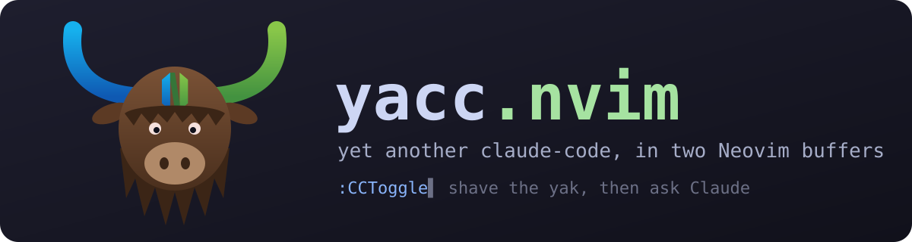
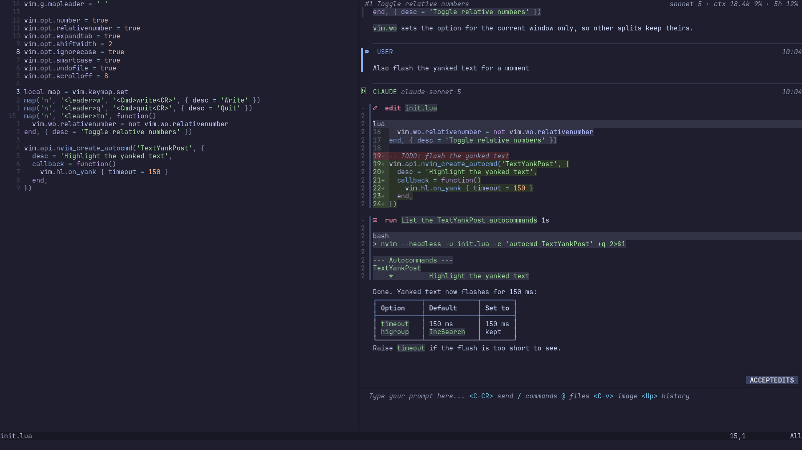

<p align="center">
  
</p>

# yacc.nvim

Yet another claude-code plugin. yacc.nvim runs [Claude Code](https://docs.anthropic.com/en/docs/claude-code)
inside Neovim as a chat. You type in an input buffer and read the answers in an output buffer rendered as
markdown. Tool calls fold away under their title. Several sessions can run at once.

It drives `claude -p` with the stream-json protocol on stdin and stdout. It has no terminal or TUI in between
and no MCP server. The layout follows [opencode.nvim](https://github.com/sudo-tee/opencode.nvim).



> [!NOTE]
> **AI disclosure.** Claude was used to write this plugin.

## Features

- **Chat layout.** Each message starts with a rule and a role row. Your prompts have a colored bar. Claude's
  text streams token by token. The winbar shows the model, the context use and the 5-hour plan usage. A
  footer shows what Claude is doing, the queue and the permission mode.
- **Folds.** Every tool call folds to its title, with its duration and a ✗ when it failed. Code blocks in
  answers fold when they are longer than `code_fold_lines`.
- **Sessions.** Run several sessions at once. `:CCSessions` resumes a past session of the repository, across
  its git worktrees like the CLI, and `<C-a>` in the picker lists every project. `:CCSearch` fuzzy searches
  the prompts and answers of past sessions, with a rendered preview.
- **Queue and send delay.** A message sent during a turn waits at the end of the output as a grey bubble
  until the CLI takes it. Every message waits `send_delay_ms` (1 s) before it leaves, and the interrupt key
  cancels it in that time. `<Up>` takes a waiting message back into the input.
- **Permissions.** The CLI asks through `vim.ui.select`: allow, allow always, show the diff, deny, or deny
  with a message.
- **Navigation.** `[[` and `]]` jump between your prompts, and from the last prompt into the input. Vim marks
  set in the output show at the right edge and are saved per session. `:CCPrompts` and `:CCMarks` list them.
- **Running tasks.** Shells and subagents show a live status after their title. `:CCTasks` lists them and
  stops one with `<C-x>`.
- **Input.** `/` completes the slash commands of the CLI and of the plugin through blink.cmp. `@` picks files
  to mention. `<C-v>` pastes an image from the clipboard. `<Up>` and `<Down>` walk the prompt history.
- **Suggestions.** With `suggestions = true`, the next prompt the CLI suggests shows as blink.cmp ghost text
  in the empty input, `<C-y>` takes it.
- **Tables** wider than the window get their cells wrapped by render-markdown 8.13+ (`pipe_table.wrap`).
- **Remote Control.** `:CCRemote` lets you continue a session from claude.ai or the mobile app. Its URL is
  copied to the `+` register and an `RC` badge shows in the winbar. Prompts sent from there show in the
  output like yours.
- **Terminal fallback.** `:CCTerm` continues the session in the interactive CLI and reloads it here when you
  quit.

## Requirements

- Neovim 0.12, tested with 0.12.5.
- [Claude Code](https://docs.anthropic.com/en/docs/claude-code) logged in, tested with 2.1.280.
- The treesitter `markdown` and `markdown_inline` parsers.
- Optional:
  - [render-markdown.nvim](https://github.com/MeanderingProgrammer/render-markdown.nvim) renders the output.
  - [snacks.nvim](https://github.com/folke/snacks.nvim) gives the pickers and previews, and `:CCTerm` its
    window. Without it the pickers fall back to `vim.ui.select`, and `:CCSearch` needs it.
  - [blink.cmp](https://github.com/saghen/blink.cmp) completes slash commands and shows suggestions.
  - `wl-paste` (Wayland) or `xclip` (X11) to paste images, and ImageMagick to shrink large ones.

## Installation

With `vim.pack`:

```lua
vim.pack.add { 'https://github.com/fymyte/yacc.nvim' }
require('yacc').setup { keys = { toggle = '<M-o>' } }
```

With lazy.nvim:

```lua
{
  'fymyte/yacc.nvim',
  opts = { keys = { toggle = '<M-o>' } },
}
```

### Rendering

Add the output filetype to render-markdown. Turn off anti-conceal there, or the line under the cursor jumps
between its raw and rendered forms while Claude writes:

```lua
require('render-markdown').setup {
  file_types = { 'markdown', 'cc-output' },
  overrides = { filetype = { ['cc-output'] = { anti_conceal = { enabled = false } } } },
}
```

### Completion

When blink.cmp is installed, yacc.nvim adds its source as `claude` for the `cc-input` filetype on the first
session. Set `blink = false` to leave blink alone. Suggestions also need ghost text in the input:

```lua
-- In blink.cmp's setup
completion = {
  ghost_text = {
    enabled = function()
      return vim.bo.filetype == 'cc-input'
    end,
  },
},
```

## Subscription or API Key

The CLI bills an `ANTHROPIC_API_KEY` from the environment without asking when it runs with `-p`. yacc.nvim
removes that variable from the `claude` environment, so a logged-in subscription is used. Set
`allow_api_key = true` to keep it.

## Commands

| Command | Does |
| --- | --- |
| `:[N]CCToggle` | Show or hide the panel. A count picks session N |
| `:CCNew` | Start a new session |
| `:CCSessions[!]` | Resume a session of this repository, `!` for every project |
| `:CCSearch[!]` | Fuzzy search past sessions, `!` for every project |
| `:[N]CCClose` | Stop a session and wipe its buffers |
| `:CCInterrupt` | Interrupt the running turn |
| `:[range]CCAdd` | Mention the current file, or the selected lines, in the input |
| `:CCMode [mode]` | Set the permission mode, or pick one |
| `:CCModel [model]` | Set the model, or pick one from the CLI's list |
| `:CCPrompts` | Pick one of your prompts and jump to it |
| `:CCMarks` | Pick a mark of the conversation and jump to it |
| `:CCTasks` | Pick a running shell or subagent, jump to it or stop it |
| `:CCRemote[!]` | Turn Remote Control on for the session, `!` turns it off |
| `:CCPermission` | Answer the pending permission prompts |
| `:CCTerm` | Continue the session in the interactive CLI |

The input also answers these slash commands itself: `/model`, `/mode`, `/clear`, `/resume`, `/search`,
`/tasks`, `/remote-control` (or `/rc`) and `/close-session` (or `/close`). Other slash commands, skills
included, go to the CLI. Add your own with the `commands` option.

## Keys

All of them are options under `keys`. A list option takes several keys, `false` or `{}` turns one off.

| Key | Where | Does |
| --- | --- | --- |
| `toggle` (none) | everywhere | Show or hide the panel |
| `<C-CR>` `<S-CR>` | input, insert | Send |
| `<CR>` | input, normal | Send |
| `<C-c>` | both | Cancel a message in its send delay, else interrupt the turn |
| `<Up>` `<Down>` | input, first or last line | Take a queued message back, else walk the history |
| `@` | input, insert | Pick files to mention |
| `<C-v>` | input, insert | Paste the clipboard image, if it holds one |
| `<C-w>` | input, insert | Window command |
| `<C-y>` | input, normal | Take the suggested prompt |
| `q` | output | Hide the panel |
| `i` `a` | output | Go to the input |
| `[[` `]]` | output | Previous and next prompt, `]]` on the last one goes to the input |
| `[[` | input | Last prompt of the output |
| `m{a-z}` `dm{a-z}` | output | Set or delete a mark |
| `<C-x>` | tasks picker | Stop the task |

No key closes a session by default. `close` takes keys that close it when pressed twice.

## Configuration

These are the defaults:

```lua
require('yacc').setup {
  cmd = { 'claude' }, -- the CLI and the arguments every run gets, such as { 'claude', '--add-dir', '../lib' }
  model = nil, -- the CLI's default
  permission_mode = nil, -- the CLI's default, 'auto' needs a model that supports it
  env = {},
  allow_api_key = false,
  partial_messages = true, -- stream text token by token
  max_lines = 500, -- lines kept from one tool output
  fold_tools = true,
  fold_threshold = 25, -- with fold_tools off, output lines shown before the rest folds
  code_fold_lines = 20, -- longer code blocks in answers start folded
  commands = {}, -- local slash commands, { name = { desc = '', arg = '', fn = function(session, arg) end } }
  history_limit = 50, -- sessions listed by :CCSessions
  suggestions = false, -- one more small API request after each turn
  send_delay_ms = 1000,
  remote_control = 'auto', -- true, false, or 'auto' to follow the CLI's remoteControlAtStartup setting
  blink = true, -- add the completion source to blink.cmp
  win = { width = 0.4, input_min = 0.10, input_max = 0.25 },
  keys = {
    toggle = false,
    submit_insert = { '<C-CR>', '<S-CR>' },
    submit_normal = { '<CR>' },
    interrupt = { '<C-c>' },
    close = {},
    double_press_ms = 1000,
    hide = { 'q' },
    focus_input = { 'i', 'a' },
    mention = '@',
    paste_image = '<C-v>',
    window = { '<C-w>' },
    history_prev = { '<Up>' },
    history_next = { '<Down>' },
    prompt_next = { ']]' },
    prompt_prev = { '[[' },
    mark = 'm',
    mark_delete = 'dm',
    accept_suggestion = '<C-y>',
    stop_task = '<C-x>',
  },
}
```

The buffers have the filetypes `cc-output` and `cc-input`. The highlight groups start with `Cc`, such as
`CcMessageRoleUser`, `CcHint`, `CcQueued` and `CcMark`. Their defaults are in
[`lua/yacc/init.lua`](lua/yacc/init.lua) and only apply when the colorscheme does not set them.

## Credits

- [opencode.nvim](https://github.com/sudo-tee/opencode.nvim) for the chat layout and its colors.

## License

[BSD 3-Clause](LICENSE)
